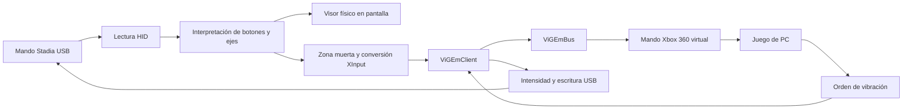

# Stadia Bridge: funcionamiento, procedencia y créditos

Documento de referencia para preparar una publicación gratuita y comunitaria en GitHub.

**Versión documentada:** 0.7.1 · **Fecha:** 20 de octubre de 2026 · **Plataforma:** Windows x64.

Este documento describe lo implementado y lo pendiente. No implica que el proyecto ya esté publicado ni que los proyectos citados avalen esta aplicación.

## 1. Qué hace el proyecto

Stadia Bridge permite utilizar un mando Google Stadia conectado por **USB** en juegos de PC que aceptan **XInput**. Incluye un visor del mando, ajustes de zona muerta, vibración USB y un instalador con las dependencias necesarias.

Windows reconoce la salida como un **mando Xbox 360 virtual**. No implementamos el protocolo de Xbox One ni un adaptador para consolas Xbox físicas.

Es una implementación propia en C# que toma como referencia el trabajo de [71/stadiacontroller](https://github.com/71/stadiacontroller) y utiliza [ViGEmClient](https://github.com/nefarius/ViGEmClient) junto con [ViGEmBus](https://github.com/nefarius/ViGEmBus). La publicación debe presentarse como una modernización independiente de la experiencia de uso del Stadia, sin atribuirnos la autoría del controlador virtual ni anunciar una actualización oficial de esos repositorios.

## 2. Cómo funciona

### Detección y entradas

1. La aplicación busca una colección HID de joystick/gamepad con identificadores USB `VID 18D1` y `PID 9400`.
2. Lee los reportes del mando con identificador `03` y obtiene botones, cruceta, sticks y gatillos.
3. El visor representa las entradas físicas antes de aplicar la zona muerta.
4. La salida convierte los sticks de 8 bits a los rangos de XInput, invierte el eje vertical y aplica la zona muerta configurada, de 0 a 30 % por eje. Los gatillos conservan su rango analógico de 0 a 255.
5. ViGEmClient envía el estado a ViGEmBus, que presenta el mando virtual a Windows y a los juegos.

Se traducen A/B/X/Y, cruceta y diagonales, LB/RB, clics de sticks, menú, vista y Stadia → Guide. Dos bits adicionales aparecen como botones extra; queda pendiente confirmar su correspondencia con Asistente y Captura, porque las referencias consultadas discrepan.

La aplicación intenta reconectar el USB con una pausa de un segundo entre intentos. Si el bus virtual no está disponible, el visor físico y la prueba USB de vibración pueden seguir funcionando.

### Vibración USB

El juego envía la intensidad de los motores grande y pequeño al mando virtual. La aplicación recibe esa notificación y un escritor asíncrono separado transmite la orden al Stadia.

El reporte de salida comienza con los bytes `[05, grande, grande, pequeño, pequeño]` y se completa hasta la longitud de salida anunciada por el dispositivo. El porcentaje de vibración ajusta ambos motores; 0 % los silencia.

La prueba heredada de consola `--test-rumble` solicita un pulso de medio segundo a ambos motores, con valor 128 sobre 255 antes de aplicar el porcentaje elegido. La interfaz 0.7.1 añade Fuerte, Suave, Ráfaga y Pulso, descritos en [Modos de vibración](docs/VIBRACION-MODOS.md). Durante la prueba sustituye temporalmente la orden del juego y después recupera la más reciente. Esta prueba no necesita ViGEmBus.

Al detener o cerrar, y ante un fallo de escritura, se intenta enviar una orden de apagado con un plazo final de 300 ms. Si se desconecta físicamente el cable, no se puede confirmar su recepción.

### Interfaz y preferencias

El dibujo del mando está implementado con gráficos propios en GDI+. Los botones se iluminan, los sticks se desplazan y los gatillos muestran su presión. También se presentan gráficos de ejes y datos de botones.

- **Neón:** acabado oscuro con acentos cian y violeta, y disposición simétrica del Stadia.
- **Clásico · Xbox:** acabado mate y distribución visual de sticks inspirada en Xbox.
- **Claro / Oscuro:** apariencia independiente del estilo del mando, con colores coordinados para paneles, bordes, botones y campos.
- Controles personalizados para selección y valores numéricos, con bordes y estados visuales integrados.

Cambiar de estilo modifica la representación, no la asignación de botones. Las preferencias de estilo y modo se guardan en `%LOCALAPPDATA%\StadiaBridge\visual-style.txt` y `color-mode.txt`. Los diagnósticos se guardan en `%LOCALAPPDATA%\StadiaBridge\Logs`.

El temporizador visual tiene un intervalo nominal de 33 ms. Ese valor **no es una medición de la frecuencia USB ni de la latencia del mando**.

## 3. Qué está comprobado y qué falta

| Área | Evidencia o estado |
| --- | --- |
| Protocolo y lógica de vibración | 1134 comprobaciones automatizadas aprobadas; no equivalen a 1098 pruebas físicas. |
| Lectura USB real | Una captura recibió 876 reportes y mostró botones B + Y activos. |
| Salida virtual | Se creó un mando Xbox virtual durante la comprobación USB. |
| Vibración manual USB | El usuario confirmó físicamente el pulso en su Stadia rev. A. |
| Entradas y vibración desde juegos | Pendiente comprobar el recorrido completo dentro de juegos. |
| Interfaz | Vistas de diseño comprobadas en ambos estilos y modos, con tamaños normal y compacto. Las vistas simuladas están identificadas como tales. |
| Instalador | Generado con dependencias incluidas; falta comprobar una instalación completa en Windows limpio. |

Limitaciones actuales: un mando físico, conexión USB, sin Bluetooth, sin reasignación ni perfiles y sin configuración de HidHide. Algunos juegos podrían leer simultáneamente el mando HID y el virtual y producir entradas duplicadas. Una revisión o firmware diferente del Stadia requiere validación.

## 4. Repositorios, herramientas y créditos

| Proyecto o referencia | Autoría / crédito | Uso en Stadia Bridge | Licencia o condición |
| --- | --- | --- | --- |
| [71/stadiacontroller](https://github.com/71/stadiacontroller) | Grégoire Geis y colaboradores | Referencia del protocolo USB, botones, vibración y enfoque de emulación. Adaptación del protocolo a nuestra implementación C#. | ISC; conservar copyright, permiso y exención de garantías. |
| [nefarius/ViGEmClient](https://github.com/nefarius/ViGEmClient) | Benjamin Höglinger-Stelzer / Nefarius y colaboradores | Biblioteca nativa que usamos para comunicarnos con el bus virtual. Se distribuye `ViGEmClient.dll` sin modificar. | MIT; conservar licencia y copyright. |
| [nefarius/ViGEmBus](https://github.com/nefarius/ViGEmBus) | Nefarius Software Solutions e.U. y colaboradores | Controlador de Windows que crea el dispositivo virtual. El instalador incluye el paquete oficial. | BSD de 3 cláusulas; conservar sus avisos y condiciones. |
| [.NET Runtime](https://github.com/dotnet/runtime) y [Windows Forms](https://github.com/dotnet/winforms) | Microsoft, .NET Foundation y colaboradores | Plataforma .NET 8 y biblioteca de interfaz de la aplicación. La distribución autónoma incorpora el runtime. | MIT y avisos de terceros de los componentes distribuidos. |
| [Inno Setup](https://github.com/jrsoftware/issrc) | Jordan Russell, Martijn Laan y colaboradores | Herramienta y motor del instalador de Windows. | Licencia propia de Inno Setup; revisar las condiciones aplicables a la versión usada. |
| [ControllerTest.io](https://controllertest.io/) | Equipo de ControllerTest.io | Referencia visual y de comportamiento aportada por el usuario: mando, sticks, gatillos y paneles. | No se ha establecido una licencia de reutilización de su código. No se incluye su HTML, JavaScript, SVG ni marca en la aplicación. |
| [REA](https://github.com/morluto/rea) | Autores y colaboradores del proyecto | Herramienta de análisis estático de archivos, bibliotecas y módulos públicos durante la investigación. | Herramienta de desarrollo; no es una dependencia incluida en la aplicación. |

El diseño, los requisitos y las pruebas físicas se realizaron con la participación del responsable de Stadia Bridge; el desarrollo contó con asistencia de Codex. No se atribuye patrocinio ni certificación a las herramientas empleadas.

El código de referencia contiene también menciones a [MWisBest/StadiEm](https://github.com/MWisBest/StadiEm). Se reconoce como antecedente citado por ese proyecto; no se incluye como dependencia directa. La conversión actual de ejes utiliza nuestro escalado monotónico.

El usuario aportó además [este video de YouTube](https://www.youtube.com/watch?v=hMulxB_33V0) como contexto. Su contenido no se verificó directamente y no se utiliza como evidencia técnica de la implementación.

Google, Stadia, Xbox y Microsoft son nombres de sus respectivos titulares y se usan para describir compatibilidad. Stadia Bridge no está afiliado a ellos.

### Versiones y procedencia verificable

**stadiacontroller:** código consultado en la revisión [`a8e6399515cbf474d4f3ec997014a47cca8d59b3`](https://github.com/71/stadiacontroller/tree/a8e6399515cbf474d4f3ec997014a47cca8d59b3). Su [licencia ISC](https://github.com/71/stadiacontroller/blob/a8e6399515cbf474d4f3ec997014a47cca8d59b3/LICENSE) corresponde a Copyright 2020 Grégoire Geis. La biblioteca nativa se obtuvo del [ZIP oficial de la versión 1.3.1](https://github.com/71/stadiacontroller/releases/tag/v1.3.1); no se ejecutó su EXE como parte de la aplicación.

**ViGEmClient:** se consultaron cabeceras en la revisión [`b66d02d57e32cc8595369c53418b843e958649b4`](https://github.com/nefarius/ViGEmClient/tree/b66d02d57e32cc8595369c53418b843e958649b4). Esa revisión identifica la referencia de API, **no demuestra de qué revisión se compiló la DLL antigua incluida en stadiacontroller**. La DLL distribuida es AMD64 y no tiene firma Authenticode.

**ViGEmBus:** instalador oficial [1.22.0](https://github.com/nefarius/ViGEmBus/releases/tag/v1.22.0), con firma Authenticode de Nefarius validada durante la preparación. El repositorio está archivado; no estamos manteniendo ni sustituyendo ese controlador. stadiacontroller también declara que ya no se mantiene.

**Entorno de empaquetado:** runtime .NET y Windows Desktop 8.0.32; Inno Setup 7.1.0. El compilador de Inno utilizado mostró «Non-commercial use only»: antes de publicar debe revisarse su licencia y las condiciones de esa edición. La licencia de una herramienta de empaquetado no debe confundirse con la licencia elegida para nuestro código.

| Archivo de origen | SHA-256 |
| --- | --- |
| `stadiacontroller.zip`, versión 1.3.1 | `820eb03606a2edc27b8d4b1db862bf7547cf74f7bfe20a0f10dd85f81d919308` |
| `ViGEmClient.dll`, extraída del ZIP anterior | `966e579ad8224ca87ae78a8788c5eb0c33ecb932dcc6ca25c39871e20b97a15a` |
| `ViGEmBus_1.22.0_x64_x86_arm64.exe` | `89220a7865076b342892f98865f3499fb7c4cfd673159e89d352c360fd014c6a` |

Los hashes permiten comprobar identidad de archivos; no sustituyen las licencias ni las pruebas de compatibilidad.

Los avisos actuales del protocolo y ViGEmClient están en [THIRD-PARTY-NOTICES.txt](THIRD-PARTY-NOTICES.txt). El paquete autónomo incluye también una carpeta `Licencias` con la licencia de ViGEmBus y los avisos de .NET. Es necesario conservarlos al redistribuir y reunir sus fuentes de manera reproducible antes de la publicación.

La investigación está registrada en [INVESTIGACION.md](docs/INVESTIGACION.md) y [VISOR-REA.md](docs/VISOR-REA.md). El análisis del sitio fue estático y parcial; no demuestra que se observara su ejecución con un mando físico.

## 5. Dónde está cada parte del código

| Ruta actual | Responsabilidad |
| --- | --- |
| `src/StadiaBridge/Program.cs` | Entrada, instancia única y opciones de diagnóstico y vista previa. |
| `src/StadiaBridge/Devices/Hid.cs` | Descubrimiento del Stadia y lectura/escritura HID. |
| `src/StadiaBridge/Protocol/Report.cs` | Interpretación del reporte físico y conversión a estado Xbox. |
| `src/StadiaBridge/Emulation/VirtualXbox.cs` | Interoperabilidad nativa y ciclo de vida del mando ViGEm. |
| `src/StadiaBridge/Vibration/Rumble.cs` | Intensidad, prueba temporal y envío asíncrono de vibración. |
| `src/StadiaBridge/UI/MainForm.cs` | Ventana, conexión, ajustes y coordinación de componentes. |
| `src/StadiaBridge/UI/ControllerDashboard.cs` | Dibujo del mando y paneles de datos. |
| `src/StadiaBridge/UI/UiTheme.cs` | Paleta de modo claro y oscuro. |
| `src/StadiaBridge/UI/NeonButton.cs` y `UI/ThemedInputs.cs` | Botones, selector y campos numéricos personalizados. |
| `tests/StadiaBridge.Checks/` | Comprobaciones del protocolo y de la lógica de vibración. |
| `lib/ViGEmClient.dll` | Dependencia nativa de terceros. |
| `installer/` | Definición e instrucciones del instalador. |
| `build.ps1` y `build-installer.ps1` | Compilación, comprobaciones y empaquetado. |
| `docs/` | Investigación, decisiones y capturas de comprobación. |

El código de la aplicación utiliza .NET 8, WinForms y llamadas nativas de Windows; no utiliza un navegador ni la Gamepad API para leer el mando. Consultar [README.md](README.md) para las instrucciones actuales de uso y compilación.

## 6. Instalador y distribución

El paquete todo en uno incluye la aplicación autónoma, el runtime y el instalador oficial de ViGEmBus. Solicita permisos de administrador para instalar en Windows. Si detecta el servicio del bus, lo conserva; de lo contrario ejecuta el instalador incluido. Puede recomendar reiniciar, sin forzar el reinicio.

Al desinstalar Stadia Bridge se conserva ViGEmBus porque puede estar compartido con otras aplicaciones. El EXE propio no está firmado; la firma comprobada del paquete oficial de ViGEmBus no firma nuestra aplicación.

Los artefactos actuales se generan dentro de `dist/`: instalador `StadiaBridge-Setup-0.7.1-x64.exe`, carpeta autónoma, carpeta portable dependiente del runtime y ZIP portable. Para GitHub deben adjuntarse a una **Release**, manteniendo el historial del repositorio centrado en código y documentación.

## 7. Preparación para publicar gratis en GitHub

La organización local ya está aplicada. La publicación remota sigue pendiente; el estado y los pasos restantes están en [PUBLICAR-GITHUB.md](docs/PUBLICAR-GITHUB.md). El instalador 0.7.0 conservado no se ha recompilado con estos cambios.

### Licencia del código propio

El objetivo es permitir que otras personas descarguen y utilicen Stadia Bridge gratuitamente. Para permitir también estudiar, modificar y redistribuir el código, se ha añadido una licencia explícita al repositorio.

Se ha añadido [MIT para el código propio](LICENSE), con el crédito colectivo «Stadia Bridge contributors». El responsable puede precisar esa identificación antes de publicar. Las licencias de los componentes externos se mantienen por separado: no podemos cambiar su autoría ni relicenciarlos como si fueran nuestros.

Dar créditos no reemplaza conservar los textos de licencia y avisos exigidos. Elegir MIT tampoco obliga a nadie a cobrar: este proyecto puede ofrecerse gratuitamente a la comunidad.

### Lista de preparación

- [ ] Elegir el nombre público del repositorio, responsable y titular del copyright.
- [x] Añadir `LICENSE` para el código propio, conservar la licencia del bus y documentar los avisos de terceros y del runtime.
- [x] Mantener la procedencia y los hashes de las dependencias, diferenciando la revisión de las cabeceras del origen de la DLL.
- [ ] Crear un paso reproducible de adquisición de ViGEmClient, ViGEmBus y la herramienta de empaquetado, con versiones fijas y comprobación de hashes y firmas cuando existan.
- [x] Comprobar la compilación y las 1098 verificaciones desde una copia sin `bin/` ni `obj/`, con restauración desde la caché local. Falta comprobar el empaquetado en Windows limpio y la primera ejecución remota de Actions.
- [x] Separar protocolo, dispositivos, emulación, vibración y presentación en carpetas, actualizando las rutas de las comprobaciones.
- [x] Centralizar la versión en `Directory.Build.props` para la aplicación, el instalador y sus nombres de artefactos.
- [x] Preparar un flujo de GitHub Actions en Windows que comprueba y compila la variante portable. Falta ejecutarlo en GitHub; no publica artefactos automáticamente.
- [x] Preparar `CHANGELOG.md`, `CONTRIBUTING.md` y una plantilla de incidencias.
- [ ] Revisar capturas y diagnósticos antes de subirlos: retirar rutas personales, números de serie y datos locales.
- [x] Configurar `.gitignore` para excluir cachés, `bin/`, `obj/`, herramientas descargadas, `research/`, `dist/`, capturas locales, archivos del editor y registros. Revisar el conjunto final antes de publicarlo.
- [ ] No subir los módulos descargados de ControllerTest.io como parte de nuestro código ni incluir repositorios de investigación anidados.
- [ ] Probar instalación, actualización y desinstalación en Windows limpio, además de entradas y vibración dentro de juegos.
- [ ] Publicar una Release con instalador, versión portable, notas de cambios, hashes y avisos de licencias.

La organización actual utiliza `Devices/`, `Protocol/`, `Emulation/`, `Vibration/` y `UI/`, conservando el namespace y el comportamiento del código. La preparación de dependencias se encuentra en `scripts/Get-Dependencies.ps1`; el compilador del instalador aún requiere preparación manual.

### Descripción sugerida para el repositorio

> Stadia Bridge es una aplicación gratuita para Windows que convierte las entradas de un mando Google Stadia USB en un mando Xbox 360 virtual compatible con XInput. Incluye un visor interactivo, estilos neón y clásico, modos claro y oscuro, zona muerta y vibración USB. Proyecto independiente inspirado en 71/stadiacontroller, construido sobre ViGEmClient y ViGEmBus, con reconocimiento a sus autores y respeto a sus licencias. Bluetooth todavía no está implementado.

Hasta completar las comprobaciones pendientes, las notas de publicación deben indicar que se trata de una versión preliminar y describir exactamente qué se ha probado.

