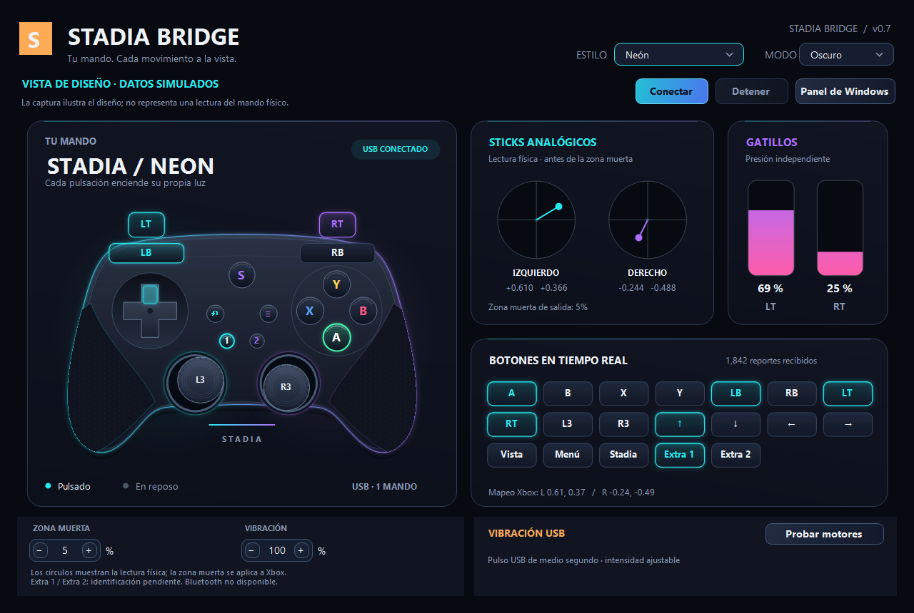
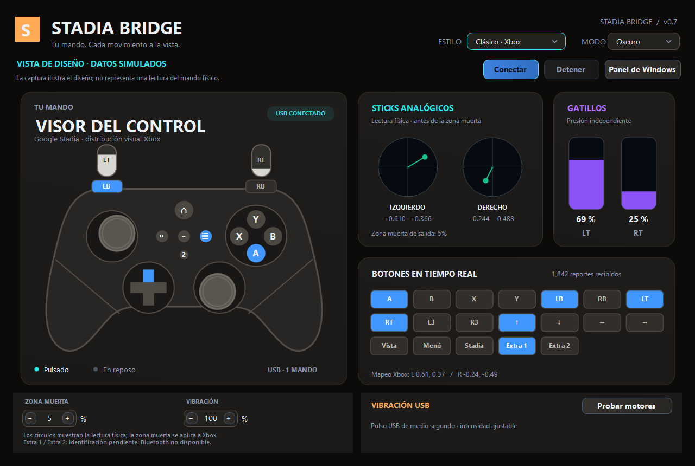
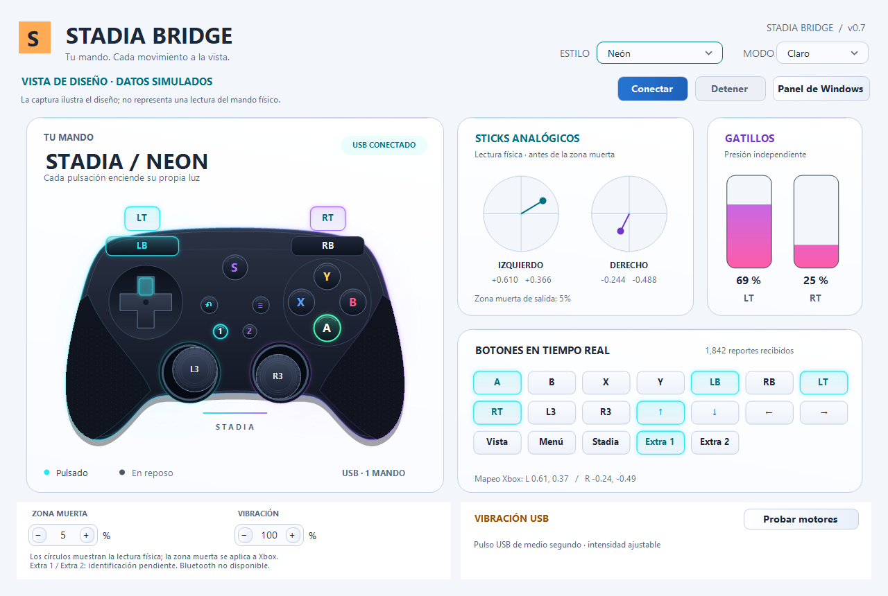
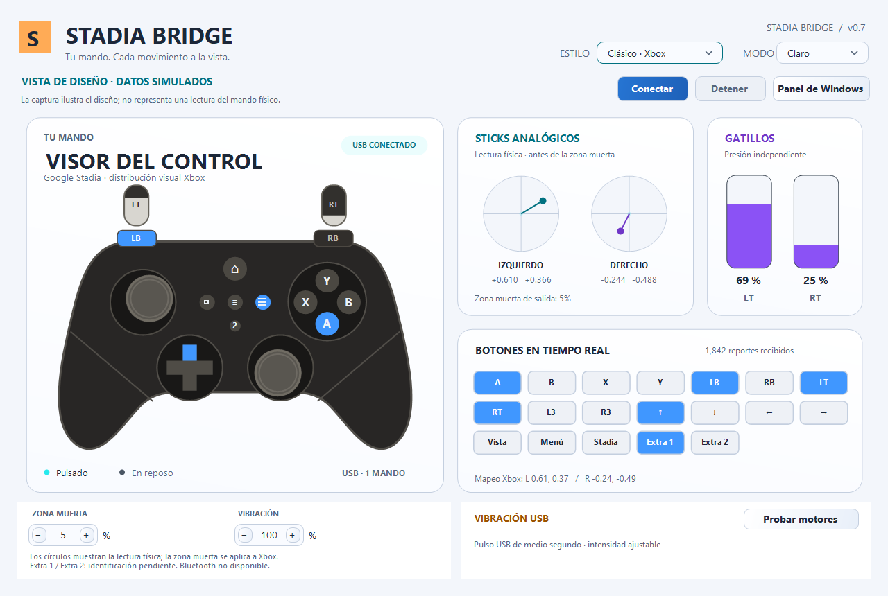

# Stadia Bridge

<p align="center">
  <a href="#english"><b>English</b></a> &nbsp;|&nbsp; <a href="#español"><b>Español</b></a>
</p>

<p align="center">
  <a href="https://github.com/AaronRouge/StadiaBridge-2026/releases/download/v0.7.2/StadiaBridge-Setup-0.7.2-x64.exe">
    
  </a>
  &nbsp;&nbsp;
  <a href="https://github.com/AaronRouge/StadiaBridge-2026/releases/latest">
    
  </a>
</p>

<p align="center">
  
  
</p>
<p align="center">
  
  
</p>

---

<a name="english"></a>
## English

Free, standalone Windows x64 application that turns your **Google Stadia USB controller** into a **virtual Xbox 360 controller compatible with XInput**. Features an interactive real-time visual dashboard, Neon and Classic Xbox themes, Dark and Light modes, deadzone adjustments, and dual-motor USB rumble.

Independent project developed and maintained by [AaronRouge](https://github.com/AaronRouge). Powered by [ViGEmClient](https://github.com/nefarius/ViGEmClient) / [ViGEmBus](https://github.com/nefarius/ViGEmBus) virtual emulation and inspired by the protocol research of [71/stadiacontroller](https://github.com/71/stadiacontroller). Full credits, licenses, and architecture details are documented in [Funcionamiento y créditos](FUNCIONAMIENTO-Y-CREDITOS.md).

### 🚀 Direct Download & Installation

Click the link below to download the ready-to-use installer directly:

👉 [**Download StadiaBridge-Setup-0.7.2-x64.exe (54.7 MB)**](https://github.com/AaronRouge/StadiaBridge-2026/releases/download/v0.7.2/StadiaBridge-Setup-0.7.2-x64.exe)

- **Included components**: Bundles both the application, .NET 8 runtime, and the official ViGEmBus 1.22.0 signed driver (100% offline installation, no internet needed).
- **Integrity**: Compare with [SHA-256 Checksum](https://github.com/AaronRouge/StadiaBridge-2026/releases/download/v0.7.2/StadiaBridge-Setup-0.7.2-x64.sha256).
- **All Releases**: View full changelogs and past versions in [GitHub Releases](https://github.com/AaronRouge/StadiaBridge-2026/releases).

#### Quick Start:
1. Run the downloaded installer and accept the Windows Administrator elevation prompt.
2. Restart your computer only if prompted by the driver installer.
3. Open **Stadia Bridge** and connect your Stadia controller using a USB data cable. Auto-detection starts immediately.
4. Press buttons and move analog sticks to verify input on the dashboard. When ViGEmBus is running, a virtual Xbox 360 controller is created automatically.
5. Use **Heavy**, **Light**, **Burst**, or **Pulse** on the vibration card to test dual-motor haptics. Adjust **Vibration (%)** or use 0% to mute.

### 🎮 Features & Specifications
- **Analog inputs**: Buttons, D-pad, thumbsticks, and analog triggers with customizable 0–30% deadzone per axis.
- **Real-time dashboard**: Illuminated buttons, movable sticks, raw physical coordinate graphs, and analog trigger gauges.
- **Customization**: Neon & Classic Xbox styles, Light & Dark themes, persistent user preferences.
- **Dual-motor rumble**: Four USB test patterns and transparent passthrough from PC games.
- **Zero latency & high reliability**: Direct native Windows HID polling (`hid.dll`) without cloud services or extra bloat.

### 🛠️ Build from Source
Requires Windows x64, .NET 8 SDK, and PowerShell:
```powershell
.\build.ps1
```
Compiles and generates the portable package in `dist/StadiaBridge/`.

---

<a name="español"></a>
## Español

<details open>
<summary><b>Haz clic aquí para contraer / expandir el manual en Español</b></summary>
<br>

Aplicación gratuita para Windows x64 que convierte un mando Google Stadia **USB** en un mando **Xbox 360 virtual compatible con XInput**. Incluye visor interactivo, estilos Neón y Clásico, modo claro y oscuro, zona muerta y vibración USB.

Proyecto independiente desarrollado y mantenido por [AaronRouge](https://github.com/AaronRouge). Con emulación [ViGEmClient](https://github.com/nefarius/ViGEmClient) / [ViGEmBus](https://github.com/nefarius/ViGEmBus) e inspirado en el protocolo de [71/stadiacontroller](https://github.com/71/stadiacontroller). Los créditos completos y licencias se detallan en [Funcionamiento y créditos](FUNCIONAMIENTO-Y-CREDITOS.md).

### 🚀 Enlace de Descarga Directa e Instalación

Si solo quieres el instalador para usar el programa, puedes descargarlo directamente aquí:

👉 [**Descargar Instalador StadiaBridge-Setup-0.7.2-x64.exe (54.7 MB)**](https://github.com/AaronRouge/StadiaBridge-2026/releases/download/v0.7.2/StadiaBridge-Setup-0.7.2-x64.exe)

- **Todo incluido**: Viene listo con .NET 8 y el instalador oficial de ViGEmBus (no requiere conexión a internet durante la instalación).
- **Seguridad**: Puedes verificar la autenticidad con el [Checksum SHA-256](https://github.com/AaronRouge/StadiaBridge-2026/releases/download/v0.7.2/StadiaBridge-Setup-0.7.2-x64.sha256).
- **Publicaciones**: Revisa el historial de versiones en [GitHub Releases](https://github.com/AaronRouge/StadiaBridge-2026/releases).

#### Pasos para usar:
1. Abre el instalador descargado y acepta el permiso de administrador de Windows.
2. Reinicia la computadora si el asistente del controlador te lo pide.
3. Abre Stadia Bridge y conecta tu mando con un cable USB de datos. La conexión comienza automáticamente.
4. Mueve las palancas y presiona botones para comprobar el visor. Al estar disponible ViGEmBus, se crea el mando Xbox 360 virtual listo para tus juegos.
5. Prueba la vibración con los botones **Fuerte**, **Suave**, **Ráfaga** o **Pulso**. El control volverá automáticamente al juego al terminar la prueba.

### 🎮 Funciones del programa
- Botones, cruceta, sticks y gatillos analógicos; zona muerta de 0 a 30 % por eje.
- Visor con botones iluminados, sticks móviles, gráficos de ejes y barras de gatillos. Muestra la lectura física antes de aplicar la zona muerta a la salida Xbox.
- Estilos Neón y Clásico · Xbox, modo Claro / Oscuro y preferencias guardadas.
- Vibración de dos motores por USB, cuatro patrones de prueba y reconexión USB automática.

### 🛠️ Compilación para desarrolladores
Requiere Windows x64, SDK .NET 8 y PowerShell. Desde la raíz:
```powershell
.\build.ps1
```
Ejecuta las comprobaciones y genera la aplicación portable en `dist/StadiaBridge/`.

### 📄 Documentación y licencia
- [Funcionamiento, procedencia y créditos](FUNCIONAMIENTO-Y-CREDITOS.md).
- [Modos de vibración USB](docs/VIBRACION-MODOS.md).
- [Historial de cambios](CHANGELOG.md) y [guía para contribuir](CONTRIBUTING.md).
- [MIT para el código propio](LICENSE), [avisos de terceros](THIRD-PARTY-NOTICES.txt) y [licencias adicionales](licenses/README.md).

Google, Stadia, Xbox y Microsoft son nombres de sus respectivos titulares. No existe afiliación ni patrocinio por parte de ellos ni de los proyectos citados.

</details>
